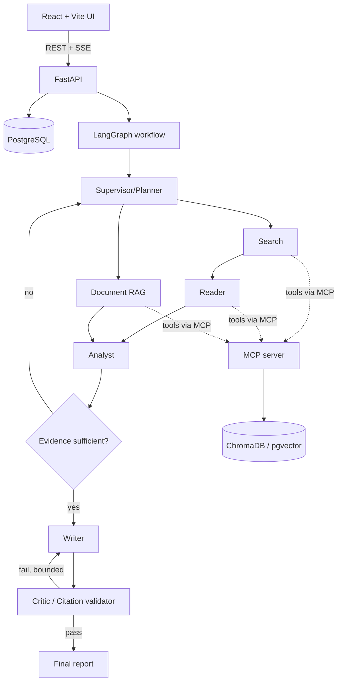

# Architecture (target design; build status per phase is in README)

Design rules: typed shared state; bounded retries/revisions; all retrieved content is untrusted
data; every outbound fetch passes `security/url_validation.py`; traces store summaries only,
never chain-of-thought.

## LLM layer (Phase 2)
`services/llm`: `LLMProvider` protocol -> adapters (`fake`, `openai` for any OpenAI-compatible
endpoint, `anthropic`). `generate_structured()` = JSON extraction + Pydantic validation + optional
business validation, with two bounded loops: transport retries (429/5xx/timeouts, exponential
backoff) and repair attempts (validation errors fed back). Tokens spent are accounted even on
failure. Errors never include keys or request bodies.

## Supervisor (Phase 2)
The LLM only *proposes* a `PlanDraft`. Code enforces: agent enum (`search|document`), mode rules,
subtask cap, acyclic dependencies, and sets the `ExecutionBudget` from research depth. The user
request is passed as delimited untrusted data with the closing tag escaped.

## Research agents (Phase 3)
Search (retry/dedupe/rank/budget) -> Reader (safe fetch, extract, LLM evidence, verbatim check)
-> Analyst (evidence-id validation, confidence cap, gaps/follow-ups) -> Writer (citation/statistic/
quote checks, Markdown). `services/pipeline.py` is the sequential baseline (bounded follow-up loop);
Phase 4 reorchestrates the same agents in LangGraph and adds the Critic.

## Workflow (Phase 4)
See [graph.md](graph.md) (generated; a test fails if it goes stale).

- **Parallelism**: `research_task` workers run per dependency wave via LangGraph `Send`; results merge
  at a single `ingest` node, which assigns S#/E# ids deterministically and enforces the source cap.
- **Routing**: after `analyze`, follow-up research (bounded by `max_iterations`, skipped when it finds
  no new evidence) or `write`; after `critic`, `revise` (bounded by `max_revisions`) or `finalize`.
- **Human-in-the-loop**: `interrupt_before=["approval_gate"]`; edits are synced into graph state on resume.
- **Persistence/resume**: JSON-only state checkpointed after every step (SQLite file; in-memory in
  tests). Failed, cancelled, timed-out and restarted runs resume from the last completed step.
- **Observability**: every node emits start/end/error events (stored in `agent_events`, streamed over SSE).
- **Critic**: deterministic checks (citation ids, statistics, quotes, sources) + LLM claim review,
  reported separately (`method`), with a disclaimer that passing is not proof of correctness.

## Tool layer (Phase 5)
Agents reach search/fetch either in-process (`direct`) or through an MCP server over stdio (`mcp`); see
[mcp.md](mcp.md). Both paths use the same provider/fetcher code and are tested to give identical results.
