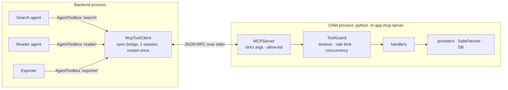

# MCP tool layer

The research tools are exposed through a real [Model Context Protocol](https://modelcontextprotocol.io)
server (official `mcp` Python SDK **2.3.0**, stdio transport) and the agents call them through a real MCP
client. Set `TOOL_TRANSPORT=mcp` to route the Search and Reader agents through it (default `direct` =
in-process calls with identical behaviour; a test proves the two paths produce identical results).



## Tools

| Tool | Inputs (validated, unknown args rejected) | Output (typed `outputSchema`) |
|---|---|---|
| `search_web` | `query` 3-300 chars, `max_results` 1-10 | provider, query, ranked hits (title, url, snippet, published_at) |
| `fetch_webpage` | `url` http(s) ≤2048, `max_chars` 500-50000 | cleaned text, title, published_at, truncated, `injection_suspected`, `untrusted: true` |
| `search_documents` | `query`, `top_k` 1-20, `document_ids` ≤20 | scored chunks with filename + page |
| `retrieve_document_chunks` | `chunk_ids` 1-20 | chunks |
| `export_research_report` | `research_id` (UUID), `format` markdown\|json | filename, content, size |

All tools are annotated read-only/idempotent (`search_web`/`fetch_webpage` also open-world).
`search_documents`/`retrieve_document_chunks` define the contract now but return `[not_available]` until the
RAG index exists (Phase 6); the server accepts any object implementing `DocumentIndex`.
PDF export is not implemented yet (Markdown and JSON are).

## Errors

Expected failures are `isError` results whose text starts with a stable code, e.g.
`[timeout:retryable] fetch_webpage exceeded its 35s time limit`. Codes: `blocked` (SSRF policy), `timeout`,
`network`, `http_error`, `too_many_redirects`, `unsupported_type`, `no_text`, `search_failed`,
`not_configured`, `not_available`, `not_found`, `too_large`, `rate_limited`, `invalid_arguments`,
`tool_disabled`, plus client-side `unavailable`, `invalid_response`, `permission_denied`.
Unexpected exceptions are logged on the server (stderr) and reported to clients as a generic error: no
paths, secrets or stack traces cross the protocol. Adapters turn codes back into the agents' native
`FetchError` / `SearchError`, so retry and degradation logic is unchanged.

## How the agents connect

1. `ToolHub` (`app/services/tooling.py`) creates one `McpToolClient` for the whole backend and hands the
   `RunManager` a tools factory. Configuration is validated before any process is spawned (503 otherwise).
2. `McpToolClient` runs the async SDK on a dedicated event-loop thread with **one** persistent stdio session;
   many worker threads can call concurrently. On a transport failure (crash, closed pipe) it restarts the
   session and retries once (safe: all tools are idempotent). Responses are re-validated against the
   published output models.
3. `AgentToolbox(client, agent)` enforces least privilege before any request is sent: Search → `search_web`,
   Reader → `fetch_webpage`, Document → document tools, Exporter → `export_research_report`. Analyst, Writer
   and Critic have **no** tools.
4. `McpSearchProvider` / `McpFetcher` adapt tool results to the interfaces the agents already use. Pages arrive
   cleaned (`FetchResult.extracted=True`), so the Reader does not re-parse them.

## Security and limits

- **Strict validation**: JSON-Schema constraints plus a middleware that rejects unknown arguments.
- **Resource limits** (env/`.env`): per-tool timeout (`MCP_TOOL_TIMEOUT_SECONDS`), concurrency cap
  (`MCP_MAX_CONCURRENCY`), calls/minute (`MCP_CALLS_PER_MINUTE`), text size (`MCP_MAX_TEXT_CHARS`), export
  size (`MCP_MAX_EXPORT_BYTES`), and a tool allow-list (`MCP_ENABLED_TOOLS`; disabled tools are not even listed).
- **SSRF**: `fetch_webpage` uses the same hardened fetcher as the direct path (hop-by-hop validation,
  connect-time IP pinning, size/time/type limits).
- **Untrusted content**: web text is returned flagged (`untrusted`, `injection_suspected`); hidden HTML is removed.
- **Least privilege for the child process**: the backend passes only the settings the tools need. The LLM API key
  is **not** passed, and the spawned server ignores `.env` (`MCP_IGNORE_DOTENV=1`).
- **stdout is the protocol channel** on stdio: the server logs to stderr only (tested).
- No orphans: the child exits when its stdin closes (verified after both SIGTERM and SIGKILL of the backend).

## Try it

```powershell
python scripts\mcp_call.py list                                   # offline fixtures
python scripts\mcp_call.py call search_web query="agentic ai" max_results=2
python scripts\mcp_call.py call fetch_webpage url=https://example.test/untrusted-page
python scripts\demo_pipeline.py --mcp --depth standard            # whole pipeline through MCP
python scripts\mcp_call.py call search_web query="your topic" --live   # real providers from backend\.env
```
Run the server by hand: `cd backend; python -m app.mcp.server` (speaks MCP on stdio; nothing is printed to
stdout). `.vscode/mcp.json` registers it for VS Code's MCP support (offline fixtures). That file and external
MCP clients (VS Code, Claude Desktop, etc.) are **untested here**; the in-repo client is what the tests cover.

## Limitations

- stdio transport only (no network exposure by design). Streamable HTTP + authentication is not implemented.
- Permissions are enforced client-side (a stdio server has one client and cannot tell agents apart); the
  server-side allow-list is the second layer. A compromised backend process could bypass the first.
- After a per-call timeout the worker thread behind the call finishes on its own (bounded by the fetcher's
  network timeouts); it cannot be killed.
- SDK note: `mcp` 2.x replaced `FastMCP` with `MCPServer` and `mcp.Client`; code written for 1.x will not run.
